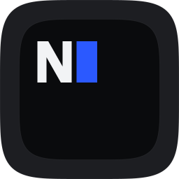

<p align="center"></p>

# Nexus

A fast agent multiplexer / IDE for macOS and Windows, built with Rust and [GPUI](https://gpui.rs).

Run Claude Code, Codex and plain shells side by side in tiled panes, browse the
project's files next to them, and jump back into any past chat from a
searchable list.

## Features

- **Tiled terminals.** Split right or down, drag dividers to resize, and keep
  several tabs per pane. Every terminal is listed in the sidebar with a dot
  showing whether it is working, finished while you were elsewhere, or rang
  the bell. `⌘1`–`⌘9` jump straight to one. (Shortcuts are written here as
  on a Mac; [Keys](#keys) lists the Windows ones.)
- **File explorer.** A lazily loaded tree of the open folder. Click a file to
  view it with syntax highlighting; the view reloads when the file changes on
  disk, so you can watch an agent edit it.
- **Agent diffs.** The file view shows what changed since the last commit
  inline: added lines in green, removed lines in red, with a `+N −M` count and
  arrows to step between changes. It updates as the agent keeps editing and
  clears when the work is committed. The `Diff` button hides the removed lines
  and leaves a bar beside the added ones. Files outside a git repository are
  compared with how they looked when you opened them.
- **⌘-click paths.** Hold `⌘` over a path an agent printed (`src/main.rs:42`,
  `Update(app/page.tsx)`, `b/src/lib.rs`, quoted paths with spaces, URLs) and
  click to open it at that line. Paths are resolved against the terminal's
  current directory and only light up if they exist.
- **Chats.** Claude Code and Codex sessions found on this machine, newest
  first, searchable by title or folder. Clicking one resumes it in the active
  pane, or focuses it if it is already open.
- **Pins and bookmarks.** Point at a chat to pin it to the top of the list or
  bookmark it; the bookmark button beside the filters narrows the list to
  bookmarked chats. Right-click an agent's tab to do the same for the chat it
  is running, or to bookmark it and close the tab in one step. Marks are
  remembered and shared by every window.
- **Files open where you expect.** A file picked in the sidebar opens as a
  tab in the focused pane. A path `⌘`-clicked in a terminal opens beside that
  terminal rather than on top of it, with the files already open.
- **Workspaces that remember.** Each folder you open is a workspace with its
  own window. Nexus saves its panes, splits, tabs, open files, sidebar and the
  chats running in its terminals, and rebuilds them when you come back:
  terminals reopen in their old folders and chats are resumed. Quit with
  windows open and the next launch reopens them.
- **Home view.** `⌘⇧N` opens a window listing your workspaces, newest first
  and searchable; pick one to enter it, or open a new folder.
- **Drag tabs.** Drag a tab along its strip to reorder it, onto another pane
  to move it there, or onto the edge of any pane to split a new pane off that
  side. The terminal or file keeps running as it moves.
- **Drag files into a chat.** Drag a file or folder from the sidebar onto a
  terminal to type its path there. An agent gets an `@` mention relative to
  its folder, which attaches the file to the chat; a shell gets the quoted
  path. Files dragged in from Finder work too.
- **Find.** `⌘F` searches the terminal's scrollback or the open file, marks
  every match and counts them. Enter steps through them (upward in a terminal,
  from the newest output back), `⇧Enter` goes the other way, and `Esc` closes
  the bar. Lowercase searches ignore case; a capital letter makes them exact.
- **Themes.** Thirteen color themes (ten dark, three light), including Owlet,
  Night Owl, Dracula, One Dark and both Solarized variants, switched from the
  palette button in the title bar and applied to every window at once.

## Install

### macOS

Download **[Nexus.dmg](https://github.com/mileslow/nexus/releases/latest/download/Nexus.dmg)**,
open it, and drag Nexus into Applications.

Releases are not notarized by Apple, so macOS blocks the first launch of a
copy downloaded with a browser: allow it under System Settings → Privacy &
Security → Open Anyway. Installing from a terminal avoids that, and also
links a `nexus` command onto your `PATH` (`nexus ~/code/app` opens a folder,
in the running app if there is one):

```sh
curl -fsSL https://raw.githubusercontent.com/mileslow/nexus/main/install.sh | sh
```

The `claude` and `codex` commands must be on the `PATH` of your login shell.

### Windows

Download and run **[Nexus-Setup.exe](https://github.com/mileslow/nexus/releases/latest/download/Nexus-Setup.exe)**
(Windows 10 or 11, 64-bit). It installs for your user only, so it never asks
for an administrator, and adds Nexus to the Start menu and **Open with
Nexus** to the folder menu in Explorer.

Releases are not signed with a Windows certificate, so SmartScreen warns on
the first run: choose **More info → Run anyway**.

Terminals run PowerShell (`pwsh` when PowerShell 7 is installed, otherwise
Windows PowerShell); set `NEXUS_SHELL` to use another, such as `cmd.exe` or
Git's `bash.exe`. The `claude` and `codex` commands must work in that shell.
Opening Nexus again, or another folder with it, reuses the copy that is
already running.

## Updates

Nexus checks for a newer release shortly after it starts and every ten minutes
after that, downloads it in the background, and shows **Restart to update** in
the title bar once it is ready. Nothing is replaced until you click it; the
restart brings your windows, layouts and chats back. **Nexus → Check for
Updates…** checks on demand (on Windows it is in the menu at the left of the
title bar). Set `NEXUS_NO_UPDATE_CHECK=1` to turn the automatic check off.

## Build from source

```sh
cargo run --release                 # reopen last time's windows, or the home view
cargo run --release -- ~/code/app   # open a folder as a workspace
scripts/bundle.sh --install         # build Nexus.app and put it in /Applications
```

The Rust toolchain is pinned in `rust-toolchain.toml` (rustup installs it on
first build). On a Mac only the Xcode Command Line Tools are needed: shaders
are compiled at runtime, so full Xcode is not required.

On Windows, build with the MSVC toolchain and the Windows SDK (the "Desktop
development with C++" workload of the Visual Studio Build Tools):

```powershell
cargo run --release                 # same as above
scripts\bundle.ps1                  # build dist\Nexus.exe
scripts\bundle.ps1 -Package         # also build the installer (needs Inno Setup 6)
```

## Publishing a release

```sh
scripts/release.sh patch    # or minor, major, or an exact version like 0.4.2
```

That bumps the version in `Cargo.toml`, commits, tags and pushes. The
[release workflow](.github/workflows/release.yml) then runs the tests and
builds on both systems, and publishes one GitHub release: `Nexus.dmg` and
`Nexus-Setup.exe` to download, plus `Nexus.zip` with `latest.json` and
`Nexus.exe` with `latest-windows.json` for the updater. Installed copies find
it on their next update check. Every push is also built and tested on both
systems by the [CI workflow](.github/workflows/ci.yml).

To sign with a Developer ID certificate instead of ad hoc, set
`NEXUS_SIGN_IDENTITY` when running `scripts/bundle.sh`. The icon is drawn in
`assets/icon.svg` and the disk image's backdrop in `assets/dmg-background.svg`;
`scripts/make-icon.sh` rebuilds the images from them, including `Nexus.ico`
for Windows. The Windows installer is described in
`scripts/windows/nexus.iss`.

## Keys

| macOS | Windows | Action |
| --- | --- | --- |
| `⌘⇧N` | `Ctrl+Shift+N` | New window on the home view |
| `⌘O` | `Ctrl+Shift+O` | Open a folder as a workspace |
| `⌘T` | `Ctrl+Shift+T` | New terminal tab |
| `⌘⇧C` / `⌘⇧X` | `Alt+Shift+C` / `Alt+Shift+X` | New Claude / Codex chat |
| `⌘D` / `⌘⇧D` | `Ctrl+Shift+D` / `Ctrl+Shift+E` | Split right / down |
| `⌘W` | `Ctrl+Shift+W` | Close tab (closes the pane with its last tab) |
| `⌘]` / `⌘[` | `Alt+→` / `Alt+←` | Next / previous pane |
| `⌃Tab` / `⌃⇧Tab` | `Ctrl+Tab` / `Ctrl+Shift+Tab` | Next / previous tab |
| `⌘1`–`⌘9` | `Alt+1`–`Alt+9` | Jump to the nth terminal in the sidebar |
| `⌘P` | `Ctrl+Shift+P` | Search chats (`↑`/`↓` to move, `Enter` to open, `Esc` to leave) |
| `⌘F` | `Ctrl+Shift+F` | Find in the terminal or file (`Enter` / `⇧Enter` to step, `Esc` to close) |
| `⌘G` / `⌘⇧G` | `F3` / `Shift+F3` | Next / previous match |
| `⌘B` | `Ctrl+Shift+B` | Toggle the sidebar |
| `⌘H` / `⌘M` | | Hide Nexus / minimize the window |
| `⌘`-click | `Ctrl`-click | Open the path or URL under the pointer |
| `⌘C` / `⌘V` / `⌘K` | `Ctrl+Shift+C` / `Ctrl+Shift+V` / `Ctrl+Shift+K` | Copy selection / paste / clear the terminal |
| `⇧PageUp` / `⇧PageDown` | same | Scroll back through terminal history |
| `⇧Enter` | same | Insert a newline in an agent prompt |
| Right-click a terminal | same | Copy the selected text, split up / right / down / left, or close it |
| Right-click a tab | same | Bookmark or pin the agent chat it runs, close it, or bookmark and close |
| Drag a tab | same | Reorder it, move it to another pane, or drop on a pane's edge to split |
| Drag a file from the sidebar | same | Type its path into the terminal or chat it is dropped on |

On Windows the plain `Ctrl` keys (`Ctrl+C`, `Ctrl+D`, `Ctrl+R`…) go to the
shell or agent in the terminal, which is why the app's own shortcuts add
`Shift`. `Ctrl+V` and `Shift+Insert` also paste.

Option acts as Meta in terminals (`⌥←`/`⌥→` move by word). Dropping files
onto a terminal pastes their paths.

## How it is built

| Module | Role |
| --- | --- |
| `terminal/` | PTY + VT emulation (`alacritty_terminal`), a custom GPUI element that paints the grid, key/mouse encoding, which shell to run, foreground-process detection for each system |
| `links.rs` | Finds file paths and URLs in a line of terminal text |
| `sessions.rs` | Discovers Claude Code and Codex chats on disk |
| `session_list.rs` | The searchable chat list |
| `file_tree.rs`, `file_view.rs` | File explorer and viewer |
| `diff.rs` | Line diff and the git baseline a file is compared against |
| `layout.rs`, `pane.rs` | The split tree and tabbed panes |
| `workspace.rs` | A workspace window: title bar, sidebar, actions, saving and restoring its layout |
| `home.rs`, `windows.rs` | The home view, and opening windows |
| `app_state.rs` | What is remembered between launches |
| `theme.rs`, `theme_picker.rs` | Color themes |
| `find.rs` | The find bar and text matching |
| `update.rs` | Finding, downloading and installing new releases |
| `platform.rs` | What differs between macOS and Windows: where files live, shortcut spellings, starting and inspecting other programs |
| `chrome.rs` | The window buttons and menu Windows leaves to the app |
| `instance.rs` | One running copy per user on Windows; later copies hand over what they were asked to open |

Performance choices worth knowing about:

- Terminal output is parsed on a dedicated thread per PTY. Wakeups are
  coalesced so a flood of output schedules at most one repaint at a time, and
  the grid is snapshotted under the lock but shaped and painted after it is
  released.
- Every list (files, chats, file lines) is virtualized.
- Chat logs can be hundreds of megabytes each, so only a bounded head and tail
  of each file is read, files are parsed in parallel, and results are cached by
  path, modification time and size in `~/Library/Caches/nexus`
  (`%LOCALAPPDATA%\Nexus\Cache` on Windows).
- Directory listing, file loading and syntax highlighting all run off the UI
  thread; highlighting streams in chunk by chunk.

## Tests

```sh
cargo test
```

Unit tests cover the non-UI logic: path detection, key and mouse encoding,
session-log parsing, chat filtering, line diffing, the pane layout tree,
saved-state round trips, theme contrast, find matching, version comparison,
swapping the app during an update, shell arguments and quoting, and the
hand-over between two copies of the app. They run on macOS and Windows.

## Not yet

- The file view is read-only and has no text selection.
- No Linux build.
